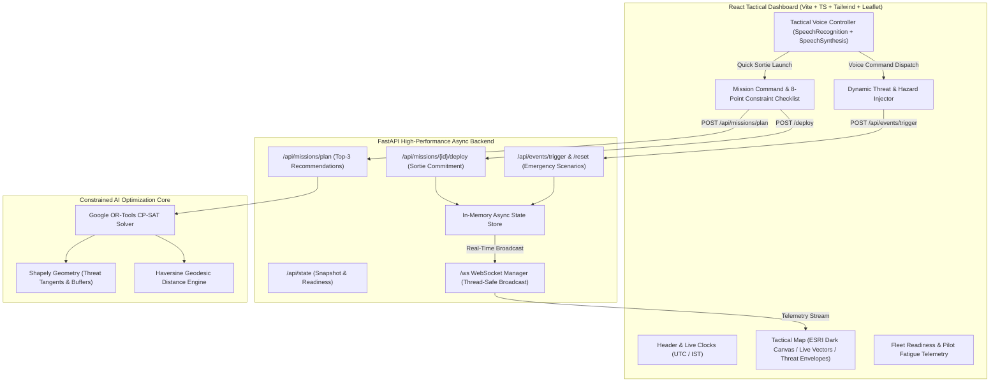

# 🇮🇳 AirPower — Bharatiya Vayu Sena Tactical Air Picture & Mission Optimization Platform

[](https://indianairforcepower.onrender.com/)
[](../LICENSE)
[](https://fastapi.tiangolo.com/)
[](https://react.dev/)
[](https://developers.google.com/optimization)

> **A Next-Generation Command-and-Control (C2) Decision-Support Platform with Real-Time Constrained AI Re-Planning, Geospatial Air Defense Tracking, and Hands-Free Voice Command Control.**

---

## 🌐 Live Deployment

Access the live operational deployment hosted on Render:
👉 **[https://indianairforcepower.onrender.com/](https://indianairforcepower.onrender.com/)**

*(Interactive Swagger API Documentation available at: [`https://indianairforcepower.onrender.com/docs`](https://indianairforcepower.onrender.com/docs))*

> ⚠️ *Note: Free-tier cloud instances may take a few moments to spin up initially if waking from idle. All operational data ingested, simulated, and displayed is purely synthetic for demonstration purposes.*

---

## 🎯 Executive Summary

Modern air warfare takes place at hypersonic speeds across high-density threat environments. Air commanders cannot rely on intuition or unconstrained black-box recommendations.

**AirPower** is an operational tactical decision-support platform designed to solve the combinatorial challenge of **sorties generation, fuel planning, pilot fatigue management, and weapons allocation**. Operating on human-in-the-loop doctrine, AirPower mathematically computes optimal packages using **Google OR-Tools CP-SAT constraint programming**, verifies all physical limits via an 8-point checklist, and streams real-time updates over low-latency WebSockets.

When in-flight contingencies arise (such as pop-up Surface-to-Air Missile radar envelopes, missile damage to runways, or mid-air engine malfunctions), AirPower's **Autonomous Re-Planning Engine** calculates collision tangents, initiates alternate recoveries, or scrambles standby alert fighters in seconds.

---

## ⚡ Core Capabilities & Highlights

| Feature | Description |
|---|---|
| **🗺️ Common Operational Picture (COP)** | Real-time geospatial dark-canvas tactical map displaying active airbases, threat radar rings, sector coverage, and animated aircraft vectors. |
| **🧠 Constrained AI Optimization** | Google OR-Tools CP-SAT multi-objective solver evaluating fuel burn, threat exposure, turnaround time, and target priorities. |
| **🎙️ Tactical Voice Command & Control** | Hands-free operation via Web Speech recognition with 2-way spoken tactical feedback and audio telemetry tones. |
| **⚠️ Dynamic Threat Injector** | Live combat injection of SAM radar bubbles, runway lockouts, and engine faults with automatic flight path rerouting. |
| **📋 8-Point Constraint Checklist** | Real-time mathematical verification of runway status, pilot rest ($8.0\text{h}+$), MTOW, munitions stock, and $1.4\times$ combat range buffer. |
| **⚡ 1-Click Local Presentation** | Pre-configured `run_local_demo.bat` script for 1-click launch during live demonstrations and evaluations. |
| **🛡️ Zero-Downtime Keep-Alive** | Integrated GitHub Actions workflow to keep cloud deployments responsive 24/7. |

---

## 🏗️ System Architecture



---

## 🎙️ Tactical Voice Commands

Click the **`🎙️ VOICE`** button on the bottom-right panel to activate tactical speech recognition. The system confirms commands via audio chime and synthesized tactical voice response.

| Voice Command | Action Executed | Tactical Response |
|---|---|---|
| `"Launch mission"` / `"Scramble fighter"` | Auto-optimizes & commits immediate sortie package to live map | *"Mission scrambled. Fighter airborne."* |
| `"SAM active"` / `"Air defense threat"` | Injects 60 km Surface-to-Air Missile threat bubble; recalculates flight route | *"Threat alert. Rerouting sortie around SAM zone."* |
| `"Runway damaged"` / `"Lock runway"` | Simulates runway strike at departure base; diverts flight to alternate airfield | *"Runway locked. Diverting to alternate airfield."* |
| `"Engine failure"` / `"Mechanical fault"` | Triggers emergency abort and scrambles standby fighter jet | *"Emergency abort. Scrambling standby aircraft."* |
| `"Reset theater"` / `"Clear simulation"` | Clears all dynamic hazards and resets fleet readiness to 100% | *"Simulation reset. All systems green."* |

---

## 📊 Hard Constraints Matrix

Every candidate sortie package generated by the solver must strictly pass an **8-Point Hard Constraint Checklist**:

| # | Constraint | Evaluation Metric | Action on Failure |
|---|---|---|---|
| **C1** | Base Runway Status | Base `runway_status == OPERATIONAL` | Candidate rejected |
| **C2** | Aircraft Availability | Status == `READY` and not airborne | Candidate rejected |
| **C3** | Pilot Stationed | Pilot stationed at departure airbase | Candidate rejected |
| **C4** | Pilot Mandatory Rest | Continuous rest $\ge 8.0$ hours | Candidate rejected |
| **C5** | Pilot Qualifications | Qualifications $\supseteq$ Target requirements | Candidate rejected |
| **C6** | Ordnance & Stock | Munition category match and stock $> 0$ | Candidate rejected |
| **C7** | Max Takeoff Weight | Empty + Fuel ($0.8\text{ kg/L}$) + Munitions $\le$ MTOW | Candidate rejected |
| **C8** | Combat Range Buffer | Max Range $\ge 2 \times \text{Distance} \times 1.4$ | Candidate rejected |

---

## 🚀 Quick Start Guide (Run Locally)

### Option A: 1-Click Launch (Windows)
Double-click **`run_local_demo.bat`** in the repository root or inside `AirPower/`.

---

### Option B: Manual Setup

#### Prerequisites
- **Python 3.10+ / 3.11+**
- **Node.js 18+ / 20+**

#### 1. Backend Setup
```bash
cd backend
python -m pip install -r requirements.txt
python -m uvicorn app.main:app --host 127.0.0.1 --port 8000 --reload
```
- API Server: `http://127.0.0.1:8000`
- Swagger Docs: `http://127.0.0.1:8000/docs`

#### 2. Frontend Setup
```bash
cd frontend
npm install
npm run dev
```
- Tactical Dashboard: **`http://localhost:5173/`**

#### 3. Run Test Suite
```bash
cd backend
python -m pytest tests/ -v
```
*(All 26 unit and integration tests validate domain models, OR-Tools constraints, and dynamic event flows).*

---

## ⏱️ 3-Minute Presentation Demo Walkthrough

1. **Opening Context (0:00 - 0:45)**:
   - Introduce the platform: *"AirPower combines Google OR-Tools CP-SAT optimization with real-time geospatial flight physics to provide mathematically verified decision support for air commanders."*
   - Highlight the **UTC/IST synchronized clocks**, **DEFCON level**, and **Fleet Readiness telemetry** (13/15 ready jets, 17/20 rested pilots).

2. **AI Mission Planning (0:45 - 1:30)**:
   - In the right-hand panel, select **Alpha Command Bunker Citadel** (Priority 5).
   - Click **OPTIMIZE**.
   - Show the **Top 3 distinct recommendations** generated within milliseconds.
   - Expand the **8-Point Constraint Checklist** proving rest hours ($\ge 8$h), range buffer ($\ge 1.4\times$), and weapon loads are verified.
   - Click **DEPLOY PACKAGE #1** to transition the sortie to `AIRBORNE` with animated neon flight vectors.

3. **Hands-Free Tactical Voice Control (1:30 - 2:30)**:
   - Click **`🎙️ VOICE`** on the bottom HUD.
   - Say: `"SAM active"` ➔ Observe spoken confirmation and automatic waypoint rerouting around the threat ring.
   - Say: `"Runway damaged"` ➔ Observe instant alternate airfield recovery diversion with calculated fuel reserve margin.
   - Say: `"Engine failure"` ➔ Observe emergency abort protocol and instant alert scramble.

4. **Reset & Clean Finish (2:30 - 3:00)**:
   - Say: `"Reset theater"` or click **`↺ Reset`** to restore baseline readiness.

---

## 🛠️ Technology Stack

- **Frontend**: React 19, TypeScript, Tailwind CSS, Lucide Icons, Leaflet / ESRI Dark Vector Canvas
- **Voice System**: Web Speech API (`webkitSpeechRecognition` + `SpeechSynthesis`) & Web Audio Synthesizer
- **Backend API**: FastAPI (Python 3.11+), Uvicorn, Asynchronous WebSockets
- **Optimization Core**: Google OR-Tools CP-SAT (Integer-scaled solver), Shapely (Spatial Geometry), Geopy
- **DevOps & Deployment**: Docker, Render Cloud Platform, GitHub Actions Keep-Alive Workflow

---

## 📜 License & Disclaimers

This project is licensed under the **MIT License**.

> *Disclaimer: All geographic points, base identifiers, mission parameters, and operational data are completely simulated and synthetic. Designed exclusively for technological demonstration and academic research.*
