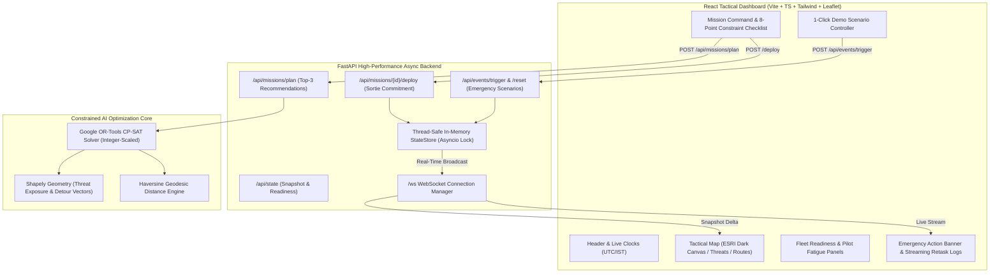

# AIRPOWER – Dynamic Air Operations & Resource Optimisation
**A Command-and-Control Decision-Support Platform with Real-Time Constrained AI Re-Planning**

---

## 🎯 Executive Summary & Concept
**AirPower** is a mission-critical tactical decision-support system designed for modern air warfare commanders. Rather than operating as an uncontrolled autonomous black-box, **AirPower recommends constrained-optimal mission packages while leaving final authorization to the human commander ("Deploy Package")**.

When theatre conditions change dynamically—such as runway lockouts from missile strikes, pop-up surface-to-air missile (SAM) radar threats, or in-flight mechanical failures—AirPower's **Real-Time Re-Planning Engine** instantly computes mathematical evasions, alternate recoveries, or replacement scrambles and streams live telemetry to all connected command dashboards.

> **Note:** All data ingested, simulated, and displayed is purely **SYNTHETIC** for hackathon demonstration purposes.

---

## 🏗 System Architecture



---

## ⚡ Key Highlights & Core Features

1. **Google OR-Tools CP-SAT Multi-Objective Optimizer**:
   - Evaluates **8 Physical & Operational Hard Constraints** across all available Aircraft $\times$ Pilot combinations.
   - Minimizes: $0.30 \cdot \text{Normalized Fuel} + 0.50 \cdot \text{Threat Exposure} + 0.20 \cdot \text{Turnaround Time} - \text{Priority Bonus}$.
   - Guarantees **Top-3 distinct aircraft** options using iterative solving and no-good cuts.
   - Comprehensive **8-Point Constraint Satisfaction Checklist** (✔/✖ with exact values).

2. **Real-Time Dynamic Emergency Re-Planning Engine**:
   - **`RUNWAY_BLOCKED`**: Automatically calculates fuel margin ($1.1\times$ reserve), selects nearest operational alternate airbase, and diverts recovery.
   - **`NEW_THREAT_ZONE`**: Shapely circle-line intersection calculates route penetration and inserts tangent detour waypoints (+15% margin) with $+X$ mins ETD delta.
   - **`AIRCRAFT_FAILURE`**: Aborts failed aircraft and scrambles standby fighter jet with matching ordnance.

3. **High-Contrast Dark Tactical Command Map**:
   - Free ESRI Dark Canvas vector tiles (no API keys required, no watermarks).
   - Clear text callouts for airbases, threat zones, targets, and animated flight polylines.
   - **"▶ 1-CLICK DEMO"** mode for instant, automated presentation to judges.

---

## 🚀 Quick Start Guide

### Prerequisites
- **Python 3.10+ or 3.11+**
- **Node.js 18+ / 20+**

### Step 1: Start Backend
```bash
cd backend
python -m uvicorn app.main:app --host 127.0.0.1 --port 8000 --reload
```
- API is live at: `http://localhost:8000`
- Interactive Swagger Documentation: `http://localhost:8000/docs`

### Step 2: Start Frontend
```bash
cd frontend
npm install
npm run dev
```
- Tactical Dashboard is live at: **`http://localhost:5173`**

### Step 3: Run Backend Test Suite
```bash
cd backend
python -m pytest tests/ -v
```
*(All 26 unit and integration tests validate domain models, constraints, and dynamic event flows).*

---

## ⏱ 3-Minute Hackathon Demo Script (For Judges)

1. **Opening Pitch (0:00 - 0:45)**:
   - *"Welcome judges. In high-tempo air warfare, commanders need instant, mathematically verified decisions—not generic suggestions. AirPower combines Google OR-Tools CP-SAT optimization with real-time geospatial physics."*
   - Point out the synchronized **UTC/IST clocks**, **DEFCON status**, and **Fleet Readiness gauges** ($13/15$ ready jets, $17/20$ rested pilots).

2. **Constrained Mission Planning (0:45 - 1:30)**:
   - On the Right Panel, select **Alpha Command Bunker Citadel** (Priority 5).
   - Click **OPTIMIZE**.
   - Show the **Top 3 distinct recommendations** generated in milliseconds.
   - Expand the **Payload & Ordnance Configuration** (showing weapon weights vs MTOW).
   - Expand the **Constraint-Satisfaction Checklist** showing all 8 hard checks passed (rest hours $\ge 8$h, range buffer $\ge 1.4\times$, all-weather qualification).
   - Click **DEPLOY PACKAGE #1** and watch the aircraft transition to `AIRBORNE` with animated neon flight lines.

3. **Emergency Scenarios & Autonomous AI Retasking (1:30 - 2:45)**:
   - Click **`1. Lock Runway (Divert)`**: Show the instant tactical alert modal as Trishul AFS is locked out and the airborne fighter is diverted to Vayu Base (+4.1 mins).
   - Click **`2. Spawn SAM (Reroute)`**: Show a 60 km SAM bubble appear directly over the corridor and observe the dynamic detour node inserted outside the threat bubble (+18.4 mins).
   - Click **`3. Engine Fault (Scramble)`**: Observe the mid-flight fault aborting the sortie and the optimizer immediately scrambling a standby replacement fighter.
   - Click **`↺ Reset`** to demonstrate full reproducibility.

4. **Alternative: 1-Click Autonomous Demo (2:45 - 3:00)**:
   - Click **`▶ 1-CLICK DEMO`** and watch the system orchestrate the entire sequence automatically with live step-by-step telemetry!

---

## 📊 Hard Constraints Matrix

| # | Constraint | Evaluation Metric | Action on Failure |
|---|---|---|---|
| **C1** | Base Runway Status | Base `runway_status == OPERATIONAL` | Candidate rejected |
| **C2** | Aircraft Availability | Status == `READY` and not airborne | Candidate rejected |
| **C3** | Pilot Stationed | Pilot stationed at departure airbase | Candidate rejected |
| **C4** | Pilot Mandatory Rest | Continuous rest $\ge 8.0$ hours | Candidate rejected |
| **C5** | Pilot Qualifications | Qualifications $\supseteq$ Target requirements | Candidate rejected |
| **C6** | Ordnance & Stock | Munition category match and stock $> 0$ | Candidate rejected |
| **C7** | Max Takeoff Weight | Empty + Fuel ($0.8\text{kg/L}$) + Munitions $\le$ MTOW | Candidate rejected |
| **C8** | Combat Range Buffer | Max Range $\ge 2 \times \text{Distance} \times 1.4$ | Candidate rejected |
